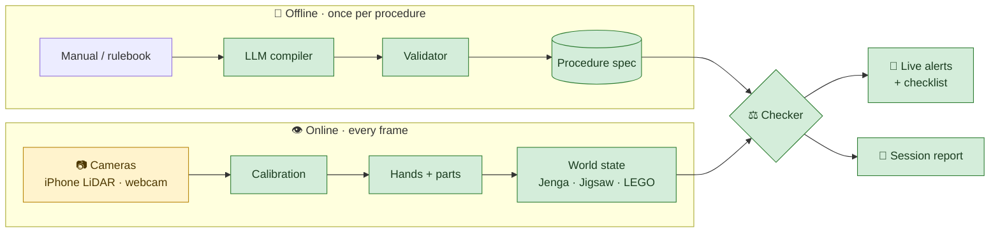

<div align="center">

# 👁️ Third Eye

### Catch mistakes in a procedure *as they happen*, from video, with rules an LLM reads from the manual.


[How it works](#how-it-works) · [Architecture](#architecture) · [Quick start](#quick-start) · [Status](#status) · [Roadmap](#roadmap)

</div>

---

## ✨ What it does

Someone plays **Jenga** or builds a **jigsaw** in front of a camera. Third Eye follows along and
flags the moment they break the procedure:

| 🚫 Alert | Example |
| :-- | :-- |
| **Illegal move** | Pulling a block from the top complete layer |
| **Out of order** | Filling the middle before the border is done |
| **Missed step** | Finishing with a gap nobody filled |
| **Wrong part** | Putting in a piece that belongs somewhere else |
| **Wrong position / rotation** | Right piece, wrong spot or turned the wrong way |

You don't write any rules by hand. Give it the **manual or rulebook as text**, and an LLM turns
it into the rules the checker enforces.

---

<a id="how-it-works"></a>

## 💡 How it works

<table>
<tr>
<td width="33%" valign="top">

### 📖 Read
**LLM compiler**, offline, once per procedure

Turns the manual into a *procedure spec*: what must be true before each move, and what the move
should change.

</td>
<td width="33%" valign="top">

### 👁️ Watch
**Computer vision**, every frame

Tracks hands and parts and keeps a live *world state*: which Jenga slots are full, which jigsaw
cells are filled.

</td>
<td width="33%" valign="top">

### ⚖️ Judge
**Deterministic checker**

Compares what the camera sees against the spec. Every alert comes from an explicit rule, never
from the LLM.

</td>
</tr>
</table>

> [!NOTE]
> **The LLM never sees video.** It only reads text: it compiles the manual, and later explains
> the session. All visual judgement is made by CV models, and every alert can be traced back to
> the rule that raised it.

---

## 🎯 Procedures

| | Procedure | Status | Why it's a good test |
| :-: | :-- | :-: | :-- |
| 🟫 | **Jenga** | 🟢 Active | **No step order, only rules.** Tests whether the system handles constraints, not just sequences. All blocks look alike, so any failure is a reasoning failure, not a detection one. |
| 🧩 | **Jigsaw** | 🟢 Active | **A grid of pieces.** Pieces are identified by matching against the box picture, so no training is needed. Its instructions are written as ordered steps (corners → edges → interior). |
| 🧱 | **LEGO** | ⏸️ Parked | The original demo. Code and tests are kept; set aside for now. |

### 📷 Hardware

- **Jenga:** an iPhone Pro with **LiDAR** at one corner of the tower (colour + depth), plus a
  second camera at the opposite corner. Depth makes empty and pushed-out slots easy to see even
  though every block is the same colour.
- **Jigsaw:** one overhead **webcam** above a board with printed ArUco markers at the corners.

---

<a id="architecture"></a>

## 🏗️ Architecture



<div align="center"><sub>🟩 built&nbsp;&nbsp;·&nbsp;&nbsp;🟨 in progress / to do</sub></div>

<details>
<summary><b>🔍 Design details</b></summary>

<br>

**One checker for every procedure.** The world state is an interface (`state/base.py`) with one
implementation per procedure. The checker never asks which one it has, so adding a new procedure
means writing a state tracker. The checker and compiler stay the same.

**Two kinds of spec:**

| Form | For | Looks like |
| :-- | :-- | :-- |
| `DagSpec` | Ordered procedures (jigsaw steps, LEGO) | Steps with parts, poses and dependencies |
| `ConstraintSpec` | Rule-based procedures (Jenga) | Actions with preconditions on the current state |

Both are lowered to the same list of actions with preconditions, so the checker has a single
code path.

**Safe rules.** Preconditions are small expressions like `src.layer < top_layer`. They're checked
against a whitelist when the spec is compiled and evaluated by an AST walker. There is no
`eval` anywhere.

**No guessing.** When the camera can't see enough to judge a move, the checker waits for a
clearer view instead of raising an alert. An alert is a claim about the user, so it never comes
from a failure of our own.

</details>

---

<a id="quick-start"></a>

## 🚀 Quick start

**1. Install** (Python 3.11+)

```bash
uv venv && source .venv/bin/activate
uv pip install -e ".[dev]"      # core + tests
```

<details>
<summary>Optional extras</summary>

```bash
uv pip install -e ".[live]"     # camera path: torch, ultralytics, mediapipe
uv pip install -e ".[llm]"      # LLM compiler: anthropic SDK
./scripts/fetch_models.sh       # MediaPipe hand model → models/
```

</details>

**2. Run the tests**, no hardware needed

```bash
pytest
```

**3. Replay a Jenga game** through the real tracker and checker

```bash
python -m thirdeye.replay scripts/scenarios/jenga_fouls.yaml
```
```text
jenga_game: 6 moves judged, 6 alerts, 0 warnings
  ended: game_over
```

or a jigsaw with an interior piece put in before the border is done:

```bash
python -m thirdeye.replay scripts/scenarios/jigsaw_early_interior.yaml
```
```text
[  11.60] ! out_of_order: The instructions finish the corners and the edges before starting on the interior. ...
jigsaw_4x3: 11/12 steps done, 1 alerts, 0 warnings
```

A spec for any rectangular jigsaw: `python -m thirdeye.compiler.jigsaw 6 4 -o specs/jigsaw_6x4.json`.

**4. Watch it in the browser**: a replay, streamed live to the demo UI

```bash
python -m thirdeye.server.app          # then open http://127.0.0.1:8000
```

Pick a scenario and press **Replay**. The checklist ticks, alerts appear, and a Jenga game shows
the tower with the legal slots outlined. The report appears at the end.

**5. Compile a manual into a spec**

```bash
export ANTHROPIC_API_KEY=...
python -m thirdeye.compiler.compile manuals/eval_corpus/jenga_standard.txt --kind constraints -o specs/jenga.json
python -m thirdeye.compiler.jigsaw 6 4 --instructions manuals/eval_corpus/jigsaw_border_first.txt -o specs/j.json
```

For a jigsaw the LLM only reads the *order* (as phases). Positions come from the board size.

**6. Measure it**

```bash
python -m thirdeye.eval.errors --scenarios scripts/scenarios        # P/R per error, false alerts, delay
python -m thirdeye.eval.robustness                                  # same, under simulated detector noise
python -m thirdeye.eval.compiler --compile                          # compiler accuracy (~20 API calls)
python -m thirdeye.explain.report run.json [--llm]                  # session report from a log
```

Once real runs are labelled (format in `thirdeye/eval/labels.py`):
`python -m thirdeye.eval.errors --labels data/labels --logs data/logs`.

> [!TIP]
> Scenario scripts describe the *scene* over time (what's on the table, where the hands are),
> not the events, so the replay exercises the same code a live camera does. Generate one per
> planted error with `scripts/make_scenarios.py`.

<details>
<summary><b>📷 Live camera: jigsaw (and LEGO, parked)</b></summary>

```bash
# jigsaw: start with the board empty; the first clear frame is taken as the empty board
python -m thirdeye.live --spec specs/jigsaw_4x3.json --reference box.jpg
# ...and record the run while it is judged, with the run id its label file will use
python -m thirdeye.live --spec specs/jigsaw_4x3.json --reference box.jpg \
    --record data/raw/jigsaw_R001.mp4 --run jigsaw_R001 --log data/logs/jigsaw_R001.json

# LEGO (parked)
python scripts/make_markers.py markers.png       # print at 100%, tape at the plate corners
python -m thirdeye.live --spec specs/model_a.json --zero-shot
```

Jenga depth (iPhone via Record3D): `python -m thirdeye.perception.record3d game.r3d` describes a
recording. `thirdeye.perception.tower` turns two corner depth views into slot occupancy.

</details>

---

<a id="status"></a>

## 📊 Project status

| Component | | Notes |
| :-- | :-: | :-- |
| Spec schema + validator | ✅ | Cycles, collisions, safe expressions |
| LLM compiler | ✅ | Structured output + one repair round; jigsaw instructions → phases |
| Checker engine | ✅ | One loop for both spec forms; looks again before an out-of-order alert |
| Jenga lattice + collapse detection | ✅ | |
| Jenga depth perception | ✅ | Two corner depth views → slot occupancy; synthetic-tested, not yet on a real phone |
| iPhone LiDAR input | 🟨 | Record3D `.r3d` reader built; format to confirm on a real recording; live USB stream untested |
| Calibration + hand tracking | ✅ | ArUco homography, MediaPipe |
| Session log + scripted replay | ✅ | Replay can simulate detector noise |
| Jigsaw spec, phases + board tracker | ✅ | Corners → edges → interior as phases; scripted replays |
| Jigsaw piece matching | ✅ | Against the box picture; synthetic-tested, not yet on real photos |
| Jigsaw live loop | ✅ | Webcam → matcher → tracker, with `--record`; tested on a synthetic video |
| Session report | ✅ | From the log only; LLM findings must cite a logged alert |
| Server + web UI | ✅ | FastAPI + WebSocket, one-page UI; replays today, camera path wired |
| Evaluation scripts | ✅ | Errors (P/R, false alerts, delay), noise sweep, compiler accuracy |
| Compiler eval corpus | ✅ | 16 manuals with ground truth (LEGO, jigsaw, Jenga variants); not yet run on a real LLM |
| Step recognizer | ⬜ | Benchmark on Assembly101 / EgoPER |

---

<a id="roadmap"></a>

## 🗺️ Roadmap

<details open>
<summary><b>🟫 Jenga</b></summary>

- [x] Read colour + depth from Record3D exports (`perception/record3d.py`)
- [x] Diagonal-corner views, two cameras merged (`perception/tower.py`)
- [x] Empty and pushed-out slot detection from depth
- [ ] Check the `.r3d` reader and the depth margins on a real iPhone recording
- [ ] Live loop: Record3D stream → tower reading → lattice
- [ ] Jenga rulebook → compiled spec, on a real LLM
- [ ] Record and label real games

</details>

<details open>
<summary><b>🧩 Jigsaw</b></summary>

- [x] Jigsaw spec: grid, pieces, ordered steps and rules
- [x] Piece-grid state tracker
- [x] Piece position + rotation by matching against the box picture
- [x] Live loop: webcam → matcher → tracker (`live.py`)
- [x] Jigsaw instructions → phases, through the LLM
- [ ] Tune the matcher on real photos (`python -m thirdeye.perception.pieces`)
- [ ] Record and label real runs

</details>

<details>
<summary><b>🔧 Shared</b></summary>

- [x] LLM session report (`explain/`)
- [x] FastAPI + WebSocket server and web UI
- [x] Evaluation: precision/recall per error, false alerts per run, alert delay, noise sweep
- [x] Compiler eval corpus + scorer
- [ ] Run the compiler corpus on the chosen LLM
- [ ] Step recognizer (`temporal/`)
- [ ] Update `docs/` to the current direction

</details>

<details>
<summary><b>🔭 Later</b></summary>

- [ ] Read picture-only instructions (official LEGO booklets) with a vision model: step order
      and parts from the pages, positions from LDraw files or one demonstrated build

</details>

---

## 📁 Repository layout

<details>
<summary>Show tree</summary>

```
thirdeye/
├── compiler/      📖 schema · validator · safe expressions · LLM compiler · jigsaw phases
├── perception/    👁️ calibration · hands · detection · jigsaw pieces · tower depth · Record3D
├── state/
│   ├── base.py       WorldState interface
│   ├── jenga/        tower lattice · collapse detection
│   ├── jigsaw/       piece board
│   └── lego/         stud grid · build tracker   (parked)
├── checker/       ⚖️ engine · expression evaluator · rule sets
├── eval/          📏 label format · error scorer · noise sweep · compiler scorer
├── explain/       📝 session report
├── server/        🌐 FastAPI app · WebSocket protocol · session runner
├── session.py     joins a tracker and the checker for one run
├── sessionlog.py  JSON log, the report's only input
├── replay.py      scripted sessions through the real pipeline (optionally noisy)
└── live.py        camera in, alerts out (LEGO, jigsaw)
ui/                the demo page (one HTML file)
specs/             procedure specs (JSON)
manuals/           text manuals · eval_corpus/ with ground-truth specs
scripts/           markers · scenario generator · eval corpus generator · model fetch
tests/             unit + scenario tests
docs/              project plan + requirements
```

Still empty: `temporal/`, `configs/`.

</details>

---

## 📚 Documentation

| | |
| :-- | :-- |
| 📋 [Project plan](docs/Third_Eye_Project_Plan.md) | Problem, architecture, timeline, risks |
| ✅ [Requirements](docs/Third_Eye_Requirements.md) | 255 numbered requirements, the `FR-*` / `NFR-*` IDs cited in the code |

> [!IMPORTANT]
> Both documents still describe the original **LEGO-first** plan and haven't been updated for
> the switch to Jenga + jigsaw.
