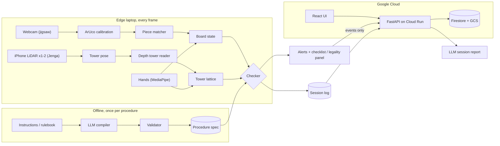

# Third Eye: Real-Time Detection of Procedural Errors from Video Using LLM-Generated Task Graphs

Plan v2.0 · 2026-10-14 · supersedes the LEGO-first plan of 2026-09-18 (kept in git history; its LEGO material is summarised in Appendix A)

Team: Aadit Pani, Megh Mavani, Mitul KM · Mentor: Prof. Manjul K Gupta · Course: CS3235

Third Eye watches someone follow a procedure through a camera and flags missed, out-of-order or wrongly executed steps, or broken rules, in real time. It checks against a machine-readable procedure spec that an LLM compiles from the written source: an instruction sheet or a rulebook.

Two demo procedures, chosen to be different in kind rather than in decoration:

- **Jigsaw puzzle**: ordered instructions ("corners, then edges, then the interior") compile to a **dependency graph** of phases. One overhead webcam.
- **Jenga**: a rulebook compiles to a **constraint set** with no fixed order. iPhone LiDAR depth from the corners of the tower.

LEGO assembly, the original demo, is **parked**: its code and tests stay in the repository and still pass, but it gets no further work this semester (Appendix A).

---

## 1. Problem and goal

Most procedural errors are omissions or wrong order, not wrong motions, and usually nobody is watching when they happen: lab work, clinical routines, manual assembly. Existing systems either classify single actions or need a custom model per task. Third Eye separates three concerns:

- **Language side (read):** an LLM reads the instructions or rulebook once and compiles them into a *procedure spec*: what must be true before an action is legal, and what each action should change.
- **Vision side (watch):** computer vision tracks hands and parts and keeps a live *world state*: which jigsaw cells hold which piece, which Jenga slots are full.
- **Checker (judge):** a deterministic engine compares what the camera saw against the spec and raises alerts. Every alert names the rule that raised it.

The LLM never sees video. It compiles text before the session and explains the log after it.

### 1.1 Why these two procedures

**Jigsaw** is the ordered procedure:

- The instructions are a sequence of phases (corners, edges, interior; or sky first; or row by row), which is exactly what a dependency graph expresses.
- Pieces are identified by matching against the **box picture**: no detector, no labelled frames, no training. A new puzzle needs only its box photo and its board size.
- Errors are easy to stage and to see: a piece in the wrong cell, turned the wrong way, an interior piece before the border is done, a piece from another puzzle, a gap at the end.

**Jenga** is the generality test, deliberately awkward for the design:

- **No step order, only rules.** Never take from the top complete layer or above; finish a layer before starting the next; one hand at a time. The compiler must emit *preconditions on an action*, not a sequence. A system that only handles ordered manuals cannot do Jenga at all.
- **The state is vertical**: an 18 x 3 slot lattice, so the world state must be an interface with several implementations rather than a hard-coded grid.
- **Every block looks the same.** A failure is unambiguously a reasoning or state failure, never a detection failure. And depth, not appearance, is what tells a hole from a block: hence LiDAR.

It is also the best live demo: a panel member plays a game and the system calls fouls as they happen.

### 1.2 The generality claim, stated precisely

| Tier | What is new | What is reused | Result it supports |
| --- | --- | --- | --- |
| 1 | An unseen jigsaw (new picture, new size, new instructions) | Same matcher, same spec form, same checker | Compiler + checker generalise across instances, with no training |
| 2 | Jenga state: a new state model and a new sensor (depth) | Same checker, same event interface | The perception and state layers are swappable behind one interface |
| 3 | The Jenga *game*: an unseen procedure topology (constraints, not order) | Same checker, same spec loader | The spec format itself is general |

Tier 3 is the claim worth making. Tier 1 alone is weak and is not presented alone.

---

## 2. System architecture

An offline path turns the written procedure into a spec, once per procedure. An online path turns video into events and world state, continuously. The checker is where they meet. A deployment layer puts the UI, the specs and the session history in the cloud while the cameras stay on an edge laptop.



### 2.1 LLM procedure compiler (offline)

Three routes, one output interface (`compiler/`):

- **Jigsaw instructions -> phases.** The model reads the instruction sheet and returns *phases* as selectors over the grid (`corners`, `edges`, `row 0`, `cells r0c0..r1c3`, `remaining`), never coordinates. Positions come from the board size, so a hallucinated cell is impossible by construction. `compiler/jigsaw.py`.
- **Rulebook -> constraint set.** Actions with preconditions (`expr`, the rule in plain words, a `violation` code) and terminal conditions. Expressions use a fixed predicate vocabulary, given in the prompt, and are evaluated by an AST walker against a whitelist; there is no `eval`. `compiler/compile.py`, `compiler/expr.py`.
- **Build manual -> DAG** (the parked LEGO route): steps with parts, poses, hard and soft dependencies.

Every route uses JSON-schema-constrained output, the same validator a hand-written spec goes through (cycles, collisions, support, satisfiability, expression whitelist), and exactly **one** automatic repair round with the problems listed. A spec that still fails goes to a person, in the UI's spec editor.

**The DAG is lowered to the constraint form.** A step's precondition is "its dependencies are done", so both procedures run through one checker code path.

**LLM provider.** Behind a one-method interface (`compiler/llm.py`), chosen by a `provider:model` string:

| Provider | Model (default) | Role |
| --- | --- | --- |
| Groq | `openai/gpt-oss-120b` | **Primary.** Free tier, strict JSON-schema decoding. Rate-limited to a few thousand tokens a minute, which the client waits out |
| Ollama | `qwen3:8b` (text), `gemma4:e4b` (vision) | Offline / local; the VLM baseline |
| Gemini | `gemini-2.5-flash` | Alternative (needs a key) |
| Claude | `claude-sonnet-5` | Alternative (needs a key) |

The CS3235 requirements doc named Gemini as primary; Groq replaced it on 2026-10-14 because it was the key available, and the corpus result (Section 7) shows it clears the targets.

### 2.2 Cameras and calibration

- **Jigsaw:** one overhead webcam. Four printed ArUco markers around the board give a homography from pixels to grid cells; any camera angle works. Loss of calibration (markers hidden) pauses judgement and shows a banner rather than emitting wrong cells.
- **Jenga:** an iPhone Pro running **Record3D** (colour + LiDAR depth over USB, or `.r3d` recordings) at one corner of the tower, and ideally a second at the **opposite** corner. Four ArUco markers on the mat around the base give each camera's pose of the tower once per session (`perception/tower.py: tower_pose`). Layers alternate direction, so a camera at a corner sees one end of *every* block; the opposite camera sees the other end. One camera works; two break the tie between a hole and a block pushed in.

### 2.3 Perception (online, per frame)

- **Hands:** MediaPipe Hand Landmarker. Jigsaw: hand over the board freezes the state. Jenga: hands are masked out of the depth map, and the number of hands touching the tower's outline is carried to the move (the one-hand rule).
- **Jigsaw pieces** (`perception/pieces.py`): rectify the board, take the centre of each cell (tabs reach into neighbours), decide occupancy against a photo of the empty board, then find the best (cell, rotation) of the box picture by texture correlation plus Lab chroma. Confidence is the gap to the runner-up, so two pieces of plain sky give a low-confidence reading and at most a yellow warning.
- **Jenga tower** (`perception/tower.py`): geometry, not detection. For every slot end a camera faces, project sample points on the end face into the depth map and compare measured with expected depth. Merge both ends: both flush = block; both recessed = hole; one in and one out = a block on the move (not settled, not judged).

### 2.4 World state

An interface (`state/base.py`) with one implementation per procedure; the checker never asks which it has.

- **Jigsaw board** (`state/jigsaw/board.py`, on the shared placement tracker): which piece sits in which cell at which rotation; a placement counts once it is stable after the hand leaves; emits `ADD`/`REMOVE` events.
- **Jenga lattice** (`state/jenga/lattice.py`): occupancy per layer, judged on settled readings only; `REMOVE`/`ADD` events, paired into moves; `COLLAPSE` from a many-layer drop in measured height held for several frames (`collapse.py`).
- The live Jenga loop (`live_jenga.py`) adds the stability filter: a reading reaches the lattice when no block is moving, no hand touches the tower, and it has held for 5 frames.

### 2.5 Step recognizer

**Demoted to Could.** For both procedures the state diff already says what happened, and the CS3235 doc lists the recognizer as a Could. If time allows it is a benchmark-only track (Assembly101 or EgoPER), off the live path. It is not started.

### 2.6 Checker (online, rules)

Per step or rule: `pending`, `active`, `done`, `error`. On every event the checker evaluates the matching action's preconditions.

| Procedure | Alerts |
| --- | --- |
| Jigsaw | missed step, out of order (phase), wrong part (another cell's or a foreign piece), wrong position, wrong rotation, extra / removed part |
| Jenga | illegal source layer, layer started early, two-handed move, wrong replacement; collapse (terminal) |

Design rules that matter for false alarms:

- **A physically impossible observation is our error, not the user's.** It triggers a re-read, and is logged as a perception miss if the re-read clears it.
- **Out-of-order waits one frame** for a re-read of the earlier step, and the end of the session takes a final look before calling a step missed. (From the noise sweep: false alerts per correct run fell from 0.30 to 0.00 at realistic noise.)
- **Below the confidence threshold, a yellow warning, never a red alert.**

### 2.7 Interface, report and deployment

- **Live view** (React): the checklist (jigsaw board with the next cell outlined) or the Jenga legality panel (the tower, the top complete layer, the legal slots outlined); red and yellow alerts with the rule's words; banners for "edge offline", "calibration lost", "compile failed".
- **Procedures**: pick a spec, or paste instructions and compile; view, edit and re-validate the JSON before saving.
- **History**: every session, its alert timeline, and its report. The report is written from the log only; the LLM version must cite a logged alert for every finding, and any red alert it leaves out is added back.
- **Deployment** (Section 3.2).

---

## 3. Tech stack and deployment

| Module | Choice | Notes |
| --- | --- | --- |
| Calibration | OpenCV ArUco + homography / PnP | |
| Hands | MediaPipe Hand Landmarker | |
| Jigsaw pieces | Own matcher against the box picture | No training |
| Jenga depth | Record3D (iPhone LiDAR), own tower reader | `.r3d` reader + USB stream |
| World state, checker | Own modules (NumPy, Python) | |
| LLM | Groq `gpt-oss-120b`; Ollama, Gemini, Claude alternatives | ~20 calls per corpus run |
| Backend | FastAPI + WebSocket | One app, laptop or Cloud Run |
| Frontend | React 19 + Vite (TypeScript) | Served by the backend; Firebase Hosting optional |
| Storage | Firestore (records) + Cloud Storage (spec JSON, logs) | Local JSON files when offline |
| Auth | Firebase Auth (Google sign-in); per-device edge token | Editors listed by email |
| Secrets | Secret Manager on Cloud Run; untracked `.env` locally | |

### 3.1 Latency budget

At 15 FPS a frame has 66 ms; the target is a whole frame (perception + state + checker) in 40 ms or less. Every live session writes its per-stage median and p95 into the log, and `python -m thirdeye.eval.latency <logs>` pools them over sessions. To be measured on the demo laptop with real cameras.

| Stage | Budget |
| --- | --- |
| Jigsaw: rectify + match 12-24 cells | 10-20 ms |
| Jenga: depth tower reading, both cameras | 10-20 ms |
| Hands | 5-10 ms |
| State + checker | < 1 ms |
| **Whole frame** | **<= 40 ms** |

### 3.2 Deployment (mandatory)

```
edge laptop  --(protocol messages + final log, HTTPS, edge token)-->  Cloud Run: FastAPI
  cameras, CV, checker                                                 |-- Firestore / GCS
browser  --(Firebase ID token)-->  Cloud Run: UI + API + WebSocket   |-- Secret Manager
```

- **Perception never runs in the cloud.** The edge (`python -m thirdeye.server.edge --cloud URL ...`) runs the session locally and forwards text: protocol messages and the final log. Video stays on the laptop unless `--send-frames` is given.
- **Replays run in the cloud**, so the public URL works with no hardware.
- `deploy/deploy.sh` creates everything (APIs, Firestore, bucket, secrets, service account, image, Cloud Run with one instance and session affinity); `deploy/hosting.sh` optionally puts the UI on Firebase Hosting. One step is manual: enabling Google sign-in in the Firebase console.

---

## 4. Implementation

### 4.1 Repository

```
thirdeye/
  compiler/   schema · validator · safe expressions · LLM compiler · jigsaw phases · llm backends
  perception/ calibration · hands · jigsaw pieces · tower depth · tower colour (baseline) · Record3D
  state/      base interface · jigsaw board · jenga lattice + collapse · lego (parked)
  checker/    engine · expression evaluator · rule sets
  eval/       labels · errors · noise sweep · compiler corpus · faithfulness · latency · VLM baseline
  explain/    session report
  server/     app · protocol · runner · store · auth · edge
  live.py         webcam loop (jigsaw; LEGO parked)
  live_jenga.py   corner depth cameras loop
  replay.py       scripted scenes through the real pipeline, optionally noisy
web/          React UI          ui/   the old one-page UI (fallback)
specs/  manuals/eval_corpus/  scripts/scenarios/  deploy/  tests/
```

### 4.2 Spec forms

The two forms and their JSON are documented in `thirdeye/compiler/schema.py`, with examples in `specs/` (`jigsaw_4x3.json` for a phased DAG, `example_constraints.json` for the Jenga rulebook). The Jenga rulebook compiles to:

```json
{ "id": "c1", "expr": "src.layer <= top_complete_layer - 1",
  "text": "Do not take from the top complete layer or above", "violation": "illegal_source_layer" }
```

### 4.3 Data flow of one Jenga frame

1. Each corner camera: colour -> tower pose (first frame only); hands -> mask + count on the tower.
2. Depth -> end-face offsets per slot -> merged slot verdicts -> height -> collapse detector.
3. Settled, hand-free and unchanged for 5 frames -> `TowerLattice.observe(occupancy, hands_in_contact=max since last)`.
4. `Session.pump()` -> move events -> preconditions -> alerts -> WebSocket (and the edge link).

---

## 5. Datasets

| Dataset | Contents | Use |
| --- | --- | --- |
| **THIRDEYE-JIGSAW (ours)** | Overhead webcam runs of 2-3 puzzles, correct and with planted errors | Error P/R, placement accuracy, latency, demo |
| **THIRDEYE-JENGA (ours)** | Record3D `.r3d` games from 1-2 corners, with planted fouls | Slot accuracy, rule P/R, collapse, demo |
| **Compiler eval corpus (ours)** | 16 manuals with hand-written ground truth: 4 jigsaw, 4 Jenga rulebooks, 8 LEGO | Compiler accuracy; released unconditionally |
| Assembly101 / EgoPER | Public procedural-error video | Only if the step recognizer (Could) is attempted |

**Recording plan.** `docs/Third_Eye_Recording_Plan.pdf`. Label format is fixed in `thirdeye/eval/labels.py` before recording; splits are by person and frozen once results are reported.

- Jigsaw: 2 puzzles (one used for tuning, one only for testing = tier 1), 3-4 people, 30-40 runs, about half with one planted error each (missing, misplaced, rotated, foreign, interior before border). `live.py --record` records while judging.
- Jenga: 12-15 games, 3 people, planted fouls (pull from the top complete layer, start a layer early, two-handed pull, wrong replacement); collapses come free.

---

## 6. Scope

### Must have

- LLM compiles jigsaw instructions and the Jenga rulebook into validated specs; accuracy measured on the corpus. **Done.**
- Jigsaw: calibration, piece matching, board state, checker (missed, out of order, wrong part / position / rotation), live loop. **Built; needs tuning on real photos.**
- Jenga: depth tower reading, lattice, all four rules + collapse, live loop. **Built; needs a real iPhone recording.**
- Web UI with live view, checklist / legality panel, alerts, history, replay without hardware, LLM report; **deployed on Google Cloud** with sign-in. **Built; deploy pending the team's Google account.**
- Evaluation on recorded runs against the targets of Section 7, with the VLM and single-sensor baselines.

### Should have

1. Two-camera Jenga rig (one camera is the fallback).
2. Tier-1 jigsaw: a second puzzle from its box photo and instructions alone.
3. Report faithfulness at or under 5% unsupported claims.

### Could have

- Step recognizer on a public benchmark (Section 2.5).
- Reading picture-only instructions with a vision model.
- Teach-by-demonstration.

### Won't have

- LEGO work beyond what exists (parked, Appendix A).
- Physics: Jenga stability or lean estimation. We check rule legality, not physics.
- Several people at once; head-mounted cameras.

---

## 7. Evaluation

Each stage is measured separately so failures are attributable. All scripts exist and run today; the **results** column says what has been measured so far.

| Question | Metric | Target | Script | Result (2026-10-14) |
| --- | --- | --- | --- | --- |
| Is the compiler right? | Step accuracy / order P/R / constraint accuracy over the corpus | >= 0.9 / >= 0.8 / reported | `eval.compiler` | **Groq gpt-oss-120b: 1.00 / 0.98 P, 1.00 R / 1.00**; 15 of 16 compiled (one LEGO manual failed after repair) |
| Does the report stay with the log? | Unsupported claims, LLM judge + manual check of 10 | <= 5% | `eval.faithfulness` | **4 of 80 claims, 5.0%** on the 16 scripted scenarios (10.5% before the writer's rules were tightened); manual check of 10 still to do |
| Are errors caught? | Precision at fixed recall, per error type | P >= 0.8 at R >= 0.8 (unseen puzzle 0.7 / 0.7) | `eval.errors` | Scripted scenarios only; needs recordings |
| Is it quiet? | False alerts per correct run | <= 1.0 | `eval.errors`, `eval.robustness` | 0.00 under simulated "real" noise; needs recordings |
| Is the jigsaw state right? | Placement accuracy (piece + cell + rotation) | >= 90% | labels `placements` | Needs recordings |
| Is the Jenga state right? | Slot occupancy accuracy; rule P/R | >= 95%; P, R >= 0.8 | labels `moves` | Synthetic only; needs a real `.r3d` |
| How early? | Median error-to-alert delay | < 2 s | `eval.errors` | Needs recordings |
| Usable live? | FPS, whole-frame ms | >= 15 FPS, <= 40 ms | `eval.latency` | Needs the demo laptop + cameras |

### Baselines

- **End-to-end VLM** (`eval.vlm_baseline`): evenly sampled frames + the instructions to a vision model, which lists the errors; written as a session log so `eval.errors` scores it by the same matching. We do not predict the outcome.
- **Colour-only piece matching** (`live.py --colour-only`): the jigsaw matcher without texture. Cannot see rotation by construction.
- **Single RGB camera, no depth** (`live_jenga.py --rgb-only`, `perception/tower_rgb.py`): end faces compared with a frame of the full tower. Expected to miss shallow middle-slot holes.
- **Compiler without constrained decoding, example or repair** (`eval.compiler --bare`; the schema is still given as text).

Compiler results on the 16-manual corpus (2026-10-14):

| Compiler | Compiled | Steps | Order P / R | Rules accuracy / precision |
| --- | --- | --- | --- | --- |
| Groq gpt-oss-120b, full | 15 / 16 | 1.00 | 0.98 / 1.00 | 1.00 / 1.00 |
| Groq gpt-oss-120b, bare baseline | 11 / 16 (3 of 4 rulebooks failed) | 0.90 | 0.94 / 1.00 | 0.67 / 0.40 |
| Ollama qwen3:8b (local), full | 7 / 16 (all 4 jigsaw, 3 of 4 rulebooks, no LEGO) | 1.00 | 0.97 / 1.00 | 0.67 / 0.85 |

The schema, the worked example and the repair round matter most for the rulebooks; the local model is a usable offline fallback for jigsaw instructions only.

### Ablations

- With vs without the re-read before out-of-order alerts (noise sweep).
- With vs without yellow warnings (`eval.errors --warnings`).
- One vs two Jenga cameras.
- LLM-compiled vs hand-written spec on the same recorded runs.
- Groq vs local Ollama on the compiler corpus.

---

## 8. Timeline from 2026-10-14

Course review dates are to be confirmed (open question 1). The order is what matters; recording is the critical path.

| Step | What | Done when |
| --- | --- | --- |
| 1 | Deploy to Google Cloud (team account, Firebase sign-in) | Public URL serves replays; edge link tested with `--scenario` |
| 2 | Jigsaw: print markers, photograph the box and the empty board, tune the matcher (`python -m thirdeye.perception.pieces`) | Real photos read correctly |
| 3 | Jenga: first real `.r3d`; check the reader and depth margins (`python -m thirdeye.perception.record3d`) | Holes in middle slots read correctly from a corner |
| 4 | Record and label jigsaw runs, then Jenga games | Label files committed; splits frozen |
| 5 | Run every evaluation, baselines and ablations | Section 7 table complete |
| 6 | Latency on the demo laptop | Budget table measured |
| 7 | Report, poster, demo video, final presentation | Submitted |

---

## 9. Work split

| Person | Owns |
| --- | --- |
| To be assigned (reasoning) | Spec schema, compiler, checker, report, compiler corpus |
| To be assigned (perception) | Calibration, piece matcher, Jenga depth tower, Record3D rig |
| To be assigned (app) | FastAPI, React UI, cloud deployment, edge link, latency |

Everyone: recording and labelling, and the report. (Roles are still placeholders in the CS3235 doc; the team assigns them.)

---

## 10. Risks and fallbacks

| Risk | Likelihood | Fallback |
| --- | --- | --- |
| `.r3d` format differs from the reader's assumptions | Medium | The reader prints what it finds; fix against the first real file before recording games |
| Middle-slot holes too shallow for LiDAR from a corner | Medium | Second camera at the opposite corner; lower the camera; the tolerance is one parameter |
| Matcher thresholds wrong on real prints and light | High | Tune on the tuning puzzle; empty-board photo is required; low-confidence readings only warn |
| Groq free-tier rate limit | Certain | The client waits it out; Ollama fallback |
| Cloud Run WebSocket drops | Medium | The UI reconnects; late joiners get the story so far; one instance, session affinity |
| Edge loses the network mid-session | Medium | Messages are queued and retried; the session runs on regardless; the log is saved locally |
| Recording slips | High | Every result except the compiler table depends on it; start with the jigsaw (no new hardware) |
| Jenga tower collapses mid-run | Certain | A terminal event, not a failure, and a demo highlight |

---

## 11. Deliverables and demo

- **Code:** public repository with setup instructions and evaluation scripts; the compiler corpus.
- **Deployed app:** public URL on Google Cloud; replay mode works with no hardware.
- **Report:** short-paper format: problem, related work, method, results, baselines, ablations, the tier 1-3 table, limitations.
- **Demo video (2-3 min):** a jigsaw done right with the board filling in; each error type caught; a second puzzle from its box photo and instructions alone; a Jenga game with fouls called live.
- **Live demo:** a panel member does the jigsaw and tries to sneak an interior piece in early, then plays Jenga and tries to cheat.

## 12. Open questions

1. Course review and submission dates.
2. Google Cloud account and credits for the deployment; who owns the Firebase project.
3. Second iPhone Pro (or another depth camera) for the opposite corner?
4. Roles in the CS3235 doc.

---

## Appendix A. LEGO (parked)

The LEGO assembly demo (two models on a studded baseplate, YOLO brick detector, stud-grid tracker, side camera for height) was the original must-have. It was parked on 2026-09-23 because the rig, the bricks and the detector labelling were the most expensive part of the plan, and the jigsaw covers the ordered-procedure case with no training. What exists and still passes its tests: the stud-grid state and build tracker (`state/lego/`), the LEGO rule set, the YOLO / YOLO-World detector wrappers, the ArUco plate calibration, scripted LEGO scenarios, and 8 LEGO manuals in the compiler corpus. Reviving it needs the rig and a labelled detector.
